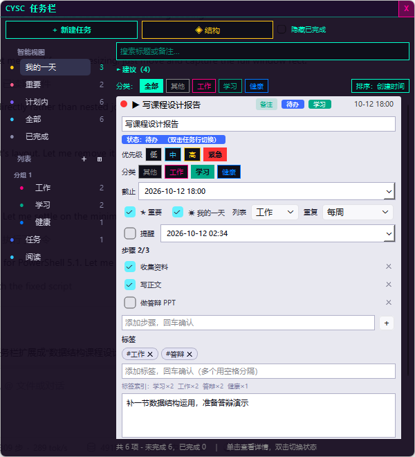
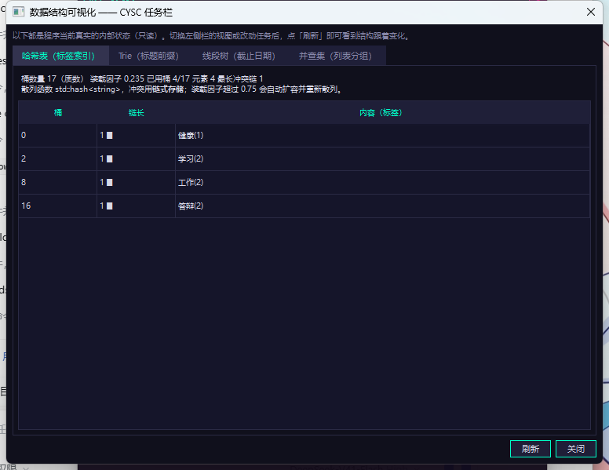
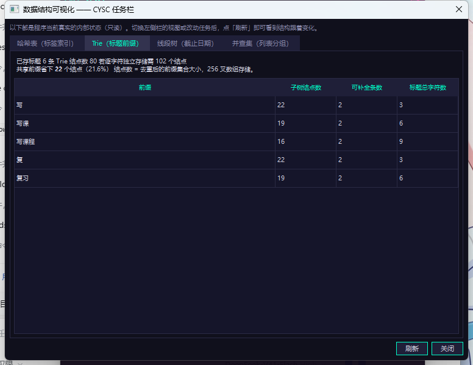
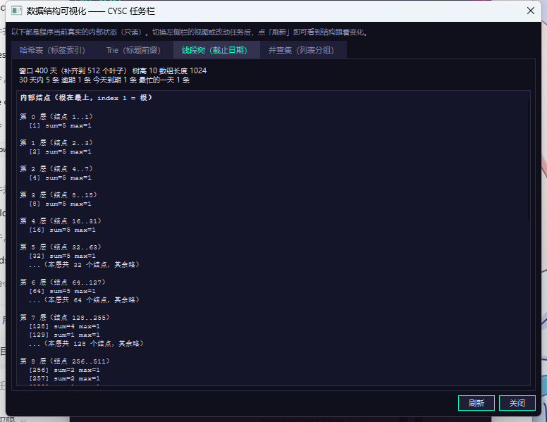
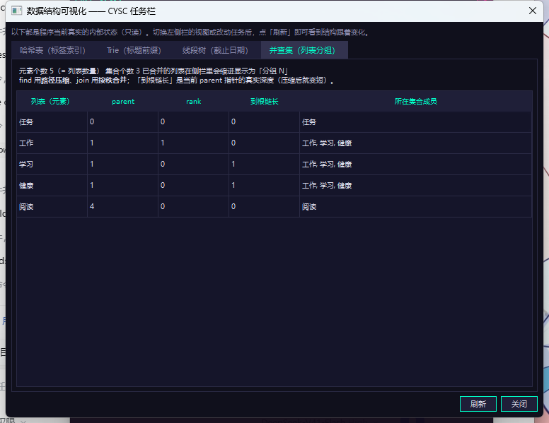

# CYSC 任务栏

[](https://github.com/zhou-yin2025/cysc-taskbar/actions/workflows/build.yml)
[](https://github.com/zhou-yin2025/cysc-taskbar/releases/latest)
[](LICENSE)
[](#下载与安装)

一个**无边框悬浮窗 + 键盘优先**的桌面任务管理工具。用 Qt 6 Widgets 与 C++17 写成，
数据落在本地 SQLite 文件里，**Windows 与 macOS 双平台原生运行**。

界面全中文，三款主题、5 档缩放、紧凑模式，常驻系统托盘。



---

## 为什么值得一试

| | |
|---|---|
| **键盘优先** | `Ctrl+N` 逐栏定义一条任务：输入名称 `Tab` 进入紧急度，`1`–`4` 选，`Enter` 随时结束。全程不碰鼠标 |
| **改完即存** | 详情面板里的改动 400 ms 后自动落库，**不收起面板** —— 你还在里面编辑 |
| **进行中自动置顶** | 状态改成「进行中」时它自己跳到最上面，边框有流动光效；完成的自动沉底并画上删除线 |
| **一行看全** | 整行高的优先级色条、状态与分类色块、截止时间右对齐。扫一眼就知道哪件事最急 |
| **不打扰** | 关窗收进托盘，到期提醒用气泡，不弹模态框 |
| **可验证** | 974 项自动化检查、双平台云端构建、安装包开箱即用（自带 Qt 与运行库）|

---

## 下载与安装

从 [**Releases 页面**](https://github.com/zhou-yin2025/cysc-taskbar/releases/latest) 下载：

| 文件 | 平台 | 说明 |
|---|---|---|
| `CYSC-Setup-win64.exe` | Windows 10/11 x64 | 安装程序，自带 Qt 与 VC++ 运行库 |
| `CYSC-Portable-win64.zip` | Windows | 便携版，解压即用 |
| `CYSC-macOS.dmg` | macOS 11+ | Intel 与 Apple Silicon 通用 |
| `README-macOS.txt` | macOS | **首次打开前请先看这个** |

### 首次打开会被系统拦（未签名，正常现象）

这个项目没有购买代码签名证书，所以：

- **Windows**：SmartScreen 提示「未知发布者」→ 点「更多信息」→「仍要运行」
- **macOS**：提示「已损坏」或「无法验证开发者」→ 打开终端执行一次：

  ```bash
  xattr -cr "/Applications/CYSC 任务栏.app"
  ```

  然后正常双击即可。若仍被拦，去「系统设置 → 隐私与安全性」点「仍要打开」。

---

## 功能

### 任务

- **三态轮转**：待办 → 进行中 → 已完成，双击切换
- **4 级优先级**（低/中/高/紧急），整行高彩色竖条表示；高与紧急额外把卡片描边换成优先级色
- **4 类分类**（其他/工作/学习/健康）+ **多标签**（多对多）
- **截止时间**精确到分钟，支持 `2026/10/12`、`10/12`、`12` 三种输入写法
- **子任务清单、星标、我的一天、重复规则、到期提醒**
- **撤销**：新增 / 修改 / 删除 / 状态变更 / 拖拽排序都能 `Ctrl+Z`

### 视图

- **左侧栏**：智能视图（我的一天 / 重要 / 计划内 / 全部 / 已完成，各自带计数）+ 自定义列表 + 列表分组
- **排序** 5 种：创建时间 / 截止时间 / 优先级 / 标题 / 手动拖拽。
  「进行中置顶」「已完成置底」在所有排序方式下都成立
- **筛选**：分类、标签、隐藏已完成
- **搜索**：标题 + 备注子串匹配，并给出**前缀补全候选**
- **「建议」面板**：自动挑出逾期与今天到期的任务
- **紧凑模式**：只显示任务，工具栏 `⊡` 一键切换；**窗口拖窄到 460 px 以下自动进入**
- **数据结构可视化面板**：实时显示四种索引结构的内部状态（只读）

### 外观

- **三款主题**

  | 主题 | 主色 | 背景 | 场景 |
  |---|---|---|---|
  | 晴空（天蓝·白） | `#1E88E5` | `#EAF4FF → #CFE4FB` | 浅色，明亮环境 |
  | 晚霞（金黄·橙） | `#FFB020` | `#2A1A22 → #160D12` | 深色，夜间，暖调 |
  | 玫瑰（玫红·浅灰·黑） | `#FF2D78` | `#1C1C1F → #0E0E10` | 深色，低饱和背景 |

- **缩放** 100% / 125% / **150%（默认）** / 175% / 200%，按屏幕可用区域自动封顶
- **动效**：「进行中」任务的边框流动光效、主窗口同款外框光效、完成时的画线动画
  （可在设置里关闭）

---

## 键盘操作

| 快捷键 | 效果 |
|---|---|
| `Ctrl+N` / `Enter` | 打开**逐栏向导**（焦点在「＋ 新建任务」按钮上时 `Enter` 即可）|
| `Ctrl+Shift+N` | 打开**完整表单**（一屏填完，含备注）|
| `Ctrl+Z` | 撤销上一步 |
| `F2` | 展开当前选中任务的详情 |
| `/` | 聚焦搜索框 |
| 向导内 `Tab` | 进入下一栏（不是切换焦点）|
| 向导内 `1`–`4` | 选择紧急度 / 分组 |
| 向导内 `Enter` | 随时结束定义，用已填内容 + 默认值建任务 |
| 向导内 `Backspace` | 回上一栏 |
| 向导内 `Esc` | 取消 |

**鼠标**

| 操作 | 效果 |
|---|---|
| 单击任务行 | 展开详情编辑区（就地改行高，不重建列表）。再点收起 |
| 双击任务行 | 推进状态。**只改状态、不动详情栏** |
| 拖动任务行 | 调整顺序并落库（在「排序：手动拖拽」下）|
| 右键任务行 | 编辑详情 / 撤销 / 标状态 / 删除 / 详情信息 |

---

## 架构

```
┌─────────────────────────────────────────────────────────┐
│  界面层   mainwindow.cpp + src/widgets/*                │
│  左侧栏 · 详情面板 · 逐栏向导 · 可视化面板 · 设置        │
└──────────────────────────┬──────────────────────────────┘
                           │ 只依赖 TaskDocument 的公开接口
┌──────────────────────────▼──────────────────────────────┐
│  应用数据层   TaskDocument                              │
│  任务 + 列表 + 分组                                      │
│  ┌────────┬────────┬──────────┬────────┐                │
│  │ 哈希表 │  Trie  │ 线段树   │ 并查集 │                │
│  └────────┴────────┴──────────┴────────┘                │
└──────────────────────────┬──────────────────────────────┘
                           │ DocumentStore / StoragePaths
┌──────────────────────────▼──────────────────────────────┐
│  持久化层   DatabaseManager（SQLite）                   │
└─────────────────────────────────────────────────────────┘
```

三条硬约束：

1. **界面层不碰 SQL** —— 只调 `TaskDocument`，换界面不用改数据逻辑
2. **数据层不碰控件** —— 字段状态机（`TaskDraft`）可脱离 GUI 单测
3. **持久化独立** —— 数据库位置可换、可测、支持便携运行

---

## 四种索引结构

四个结构都是手写实现，各自对应真实功能，不是为演示而存在。

| 结构 | 位置 | 用途 | 复杂度 |
|---|---|---|---|
| **哈希表**（链式） | `src/ds/HashTable.h` | 标签 → 任务**倒排索引**；标题归一化去重 | 平均 O(1)，装载因子 > 0.75 自动扩容 |
| **Trie**（256 叉） | `src/ds/Trie.h/.cpp` | 搜索框的**前缀补全**（删除时自底向上剪枝） | O(L)，与总词数无关 |
| **线段树** | `src/ds/SegmentTree.h` | 截止日期按天分布：任意区间统计、逾期数、逐日热力图 | 建树 O(n)，更新/查询 O(log n) |
| **并查集** | `src/ds/UnionFind.h` | 列表**分组**的合并与判同组 | 路径压缩 + 按秩合并，均摊近 O(1) |

另有 `Vector<T>`（任务存储与稳定排序）与 `Stack<T>`（撤销历史）两个自实现容器。

**两个设计细节值得说明：**

- **分组号存「组内最小的列表 id」，不存并查集根下标。**
  根下标依赖列表在数组里的位置 —— 删掉一个列表，后面所有列表的序号前移，
  分组号就整体错位。列表 id 是主键，与位置无关。
- **标签用单位分隔符 `0x1F` 连接，不用逗号。**
  标签内容本身可能含逗号，用逗号连接会串。

可视化面板可以实时看到这四种结构的内部状态：

| 哈希表：桶分布与冲突链 | Trie：共享前缀省下的结点 |
|---|---|
|  |  |

| 线段树：自根收敛 + 日热力图 | 并查集：parent / rank / 链长 |
|---|---|
|  |  |

---

## 数据存储

数据库位置按「第一个真正可写」的候选目录决定，每处都用探针文件真实验证可写性：

1. `$CYSC_DB_PATH` —— 显式覆盖，优先级最高
2. `<exe 目录>/data/cysc.db` —— 便携 / 开发布局
3. `<AppData>/cysc.db` —— 常规单用户位置
4. `<系统临时目录>/CYSC/cysc.db` —— 兜底

全部不可写时**不弹模态框卡住**，而在状态栏显示红色警告，继续以纯内存模式可用。

**三张表**：

| 表 | 用途 |
|---|---|
| `tasks` | 任务主体（标题、备注、优先级、截止时间、分类、状态、创建/完成时间、星标、我的一天、所属列表、重复、提醒、标签、手工顺序）|
| `lists` | 自定义列表（名称、颜色、分组号、是否默认）|
| `subtasks` | 子任务（任务 id、位置、标题、勾选）|

标签**没有独立表** —— 直接存在 `tasks.tags` 列里，用单位分隔符 `0x1F` 连接。
这样读一条任务只需要一次查询，代价是不能按标签做 SQL 索引（标签筛选走内存里的哈希倒排索引）。

**旧库自动升级**：建表后执行 `ALTER TABLE ... ADD COLUMN`，列已存在则忽略，
所以老版本数据库直接可用。

**写入失败回滚**：写库先行；失败则回滚内存改动并把原因记入 `lastError()`，
避免内存与磁盘静默不一致。

---

## 从源码构建

### 依赖

| 项 | 版本 |
|---|---|
| Qt | 6.5+（开发用 6.11.0；CI 上 macOS 侧固定 6.11.0）|
| CMake | 3.19+ |
| 编译器 | MSVC 2022（Windows）/ AppleClang（macOS）|
| C++ | 17 |

### Windows

```bat
scripts\build.bat Debug      :: 配置 + 编译
scripts\test.bat  Debug      :: 编译 + 跑全部测试
scripts\build.bat Release    :: 出交付版
scripts\package.bat          :: 打安装程序 + 便携版 zip
```

`scripts\build.bat` 会自动定位 Qt 与 MSVC。若路径不同，改脚本顶部的变量即可。

### macOS

```bash
cmake -S . -B build/mac -DCMAKE_BUILD_TYPE=Release \
      -DCMAKE_PREFIX_PATH="$(brew --prefix qt)" \
      -DCYSC_BUILD_TESTS=ON
cmake --build build/mac --parallel
open build/mac/cysc-taskbar.app
```

> `scripts/` 下是 Windows 批处理，macOS 上请直接用上面的 cmake 命令。

### ⚠ 改过公共头文件后必须干净重建

CMake（Ninja 与 NMake/JOM 都一样）**没有把公共头文件的依赖记全**。
改 `mainwindow.h`、`Task.h` 这类被多处包含的头之后，增量构建可能只重编一部分
`.cpp`，导致不同 `.obj` 里内联函数与类布局的定义来自不同版本源码 —— **ABI 不一致**，
表现为随机 `0xC0000005`，而且换一个构建目录就不重现。

```bat
scripts\build.bat Debug clean       :: 删掉构建目录
scripts\build.bat Debug
```

改完头文件跑一次检查：

```powershell
powershell -File tools\check_build_fresh.ps1 build\ninja-Debug
```

它会检查目标文件时间戳是否集中在同一批，分多批就警告。

---

## 测试

| 用例 | 内容 | 项数 |
|---|---|---|
| `cysc_tests` | 纯逻辑：数据结构、模型、持久化往返、排序规则、字段状态机 | **590** |
| `cysc_gui_tests` | **真实控件**离屏运行：展开/收起、拖拽、主题、光效、缩放、紧凑模式、向导每一栏 | **346** |
| `cysc_ds_demo` | 四种索引结构的演示与断言 | **38** |

一条命令跑完：

```bat
scripts\test.bat Debug
```

也可以用应用内参数人工检查：

| 参数 | 用途 | 项数 |
|---|---|---|
| `--selftest` | 应用内轻量自检（模型层）| 24 |
| `--guitest` | 界面自检（**必须**把 `CYSC_TEST_TMPDIR` 指到可写目录）| 346 |
| `--dsdemo` | 数据结构演示 | 38 |
| `--visualize` / `--visualize-tab N` | 打开可视化面板 / 指定页签 | — |
| `--theme sky\|sunset\|rose` | 指定主题启动 | — |
| `--wizard` / `--expand-first` | 启动就打开向导 / 展开第一条任务 | — |
| `--force-tray` | 强制假定托盘可用（验证「关窗收进托盘」路径）| — |

界面自检的一个原则：**不是检查布尔标志，而是把控件渲染出来数像素**。
光效第一版只画了 2 px 细线，抓图数青绿像素只有 16 个 —— 状态"对"了但看不见。

---

## 持续集成

推送到 `main` 或打 tag 时，GitHub Actions 自动构建两个平台：

```
push / tag
   ├─ windows-latest   Qt 6.8.0  → 编译 → 测试 → Inno Setup → 安装程序 + 便携 zip
   └─ macos-latest     Qt 6.11.0 → 编译 → 测试 → icns → bundle → dmg
                                   └─ 打 tag 时自动建 Release
```

> 两个平台用不同 Qt 版本不是笔误：Qt 6.8.0 的 macOS 配置会引用 Apple 早已删除的
> AGL 框架，而新版 Xcode 里没有它（`ld: framework 'AGL' not found`）。
> 6.11.0 侧无此引用；而 6.11.0 的 Windows 包在 Qt 服务器上取不到，所以 Windows 留在 6.8.0。

打包与分发的完整说明、以及这条流水线调通过程中踩过的坑，见
[`docs/打包说明.md`](docs/打包说明.md)。

---

## 目录结构

```
cysc-taskbar/
├─ CMakeLists.txt          应用 + 测试 + 3 个 CTest 用例
├─ main.cpp                入口与命令行参数
├─ mainwindow.h/.cpp       主窗口：自绘标题栏、工具栏、列表、详情面板、
│                          主题铺设、光效动画、紧凑模式、缩放、托盘、提醒
├─ src/
│  ├─ ds/                  手写数据结构
│  │  ├─ Vector.h          模板动态数组（深拷贝/扩容/归并排序）
│  │  ├─ Stack.h           模板栈
│  │  ├─ Trie.h/.cpp       256 叉前缀树
│  │  ├─ HashTable.h       链式哈希表
│  │  ├─ SegmentTree.h     线段树
│  │  └─ UnionFind.h       并查集
│  ├─ models/              任务定义、查询语义、字段状态机、数据中枢
│  ├─ core/                SQLite 封装、文档级持久化、路径探测
│  ├─ ui/                  Theme.h/.cpp —— 全项目唯一的取色来源
│  ├─ widgets/             侧栏、详情、向导、表单、分组、设置、可视化面板
│  └─ demo/                --dsdemo 演示模式
├─ tests/                  单元测试
├─ resources/              图标、Windows 资源脚本
├─ scripts/                构建 / 测试 / 打包 / Inno Setup 脚本
├─ tools/                  截图、冒烟测试、构建新鲜度检查、图标生成
└─ docs/                   打包说明与界面截图
```

C++ 源码 42 个文件、约 13,000 行。

---

## 平台验证情况

| 平台 | 验证内容 |
|---|---|
| **Windows** | 安装 → 运行 → 卸载完整验证；29 个文件落盘、快捷方式与注册表卸载项正确、装完不带 Qt 环境可独立运行 |
| **macOS** | **真机实测通过**：安装、启动、界面显示正常，无报错；关窗进托盘且托盘可点开；关掉程序重开后数据仍在；窗口失焦时不被隐藏；三款主题、缩放、紧凑模式均正常 |

---

## 已知限制

- **安装包未签名** —— Windows 与 macOS 都会提示「未知发布者 / 已损坏」，需手动放行
- **macOS 上「拖窄窗口自动进入紧凑模式」不生效** ——
  这个功能依赖窗口自绘边框的拖拽区域判定（`m_resizingByUser`），
  macOS 的无边框窗口没有把鼠标事件投到那个边缘区域。
  **工具栏的 `⊡` 按钮切换紧凑模式在 macOS 上正常**，只是"拖窄自动切"这一条不触发
- **分类项固定 4 类**，尚未做成可配置
- **筛选与排序状态不持久化**，重启回到默认
- **提醒依赖进程在运行**，没有开机自启与后台服务
- **逐栏向导不含备注字段**（备注走完整表单或列表内联编辑）
- **仅中文** —— 文案写在代码里，未走 Qt 的 `.ts` 翻译机制
- 150% 缩放下行内右侧的时间标签可能被挤出视口（时间列是固定宽度）
- **托盘图标在无交互桌面的会话里不可用** —— 此时关闭按钮就是真退出，
  状态栏会提示；可用 `--force-tray` 单独验证那条路径

---

## 许可证

[MIT](LICENSE)
